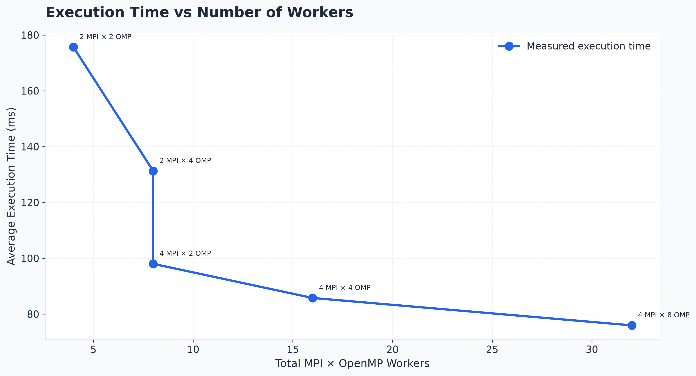
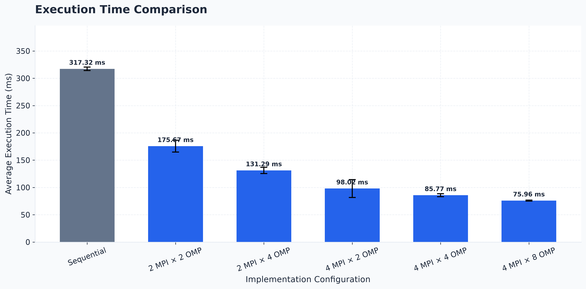
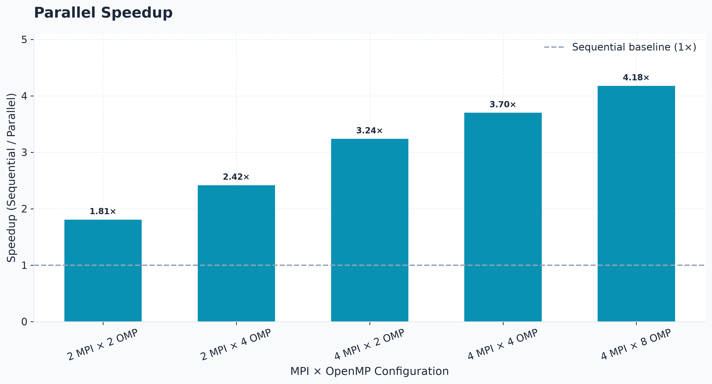
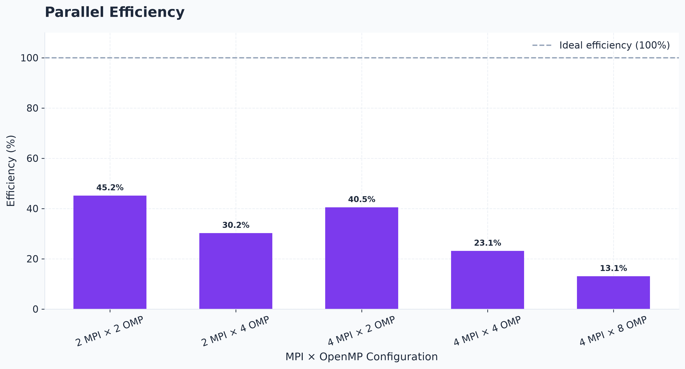
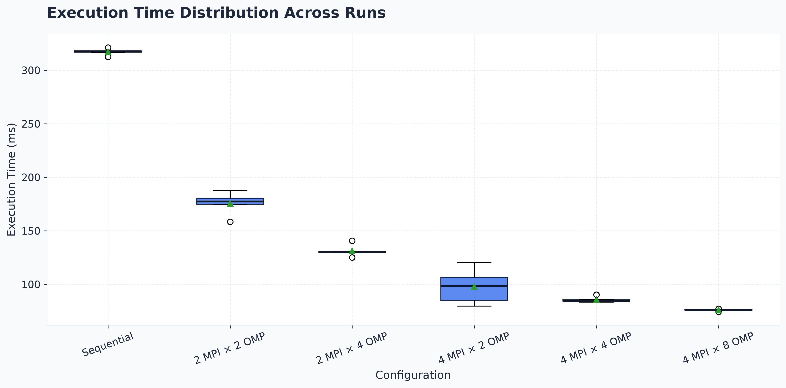
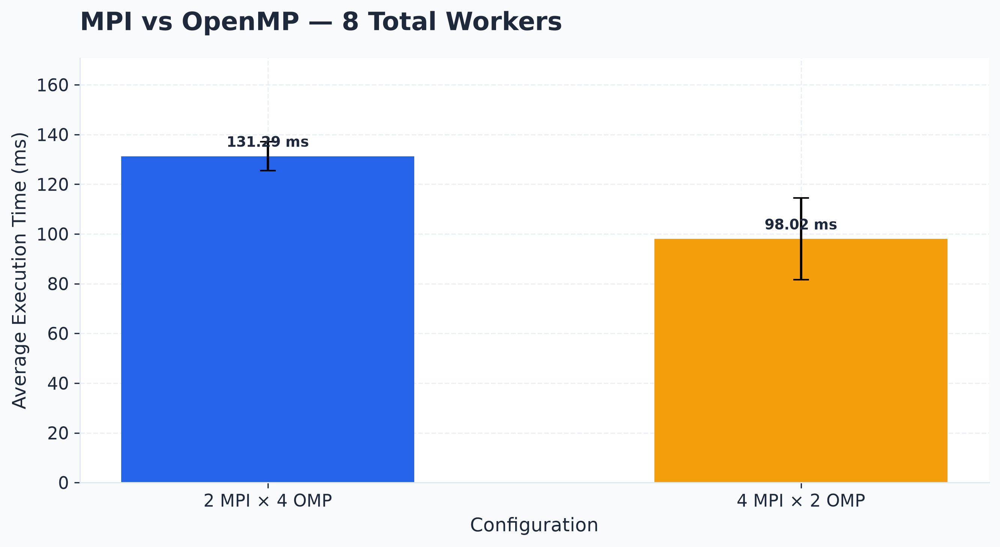
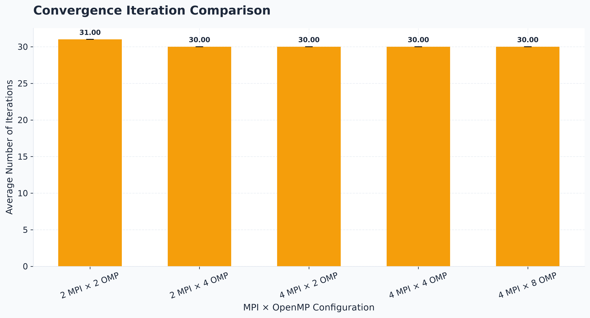
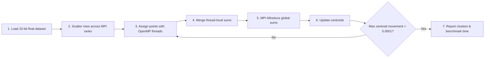

<div align="center">

# ⚡ Parallel K-Means Clustering

**A high-performance, hybrid MPI + OpenMP implementation of K-Means clustering**

[](https://en.wikipedia.org/wiki/C_(programming_language))
[](https://www.open-mpi.org/)
[](https://en.wikipedia.org/wiki/K-means_clustering)
[](#-dataset)

<br/>



*Sequential vs. hybrid parallel clustering across multiple MPI and OpenMP configurations*

</div>

---

## 🚀 What Makes This Project Fast?

This project compares a straightforward sequential K-Means implementation with a **hybrid parallel implementation** that combines:

| Technology | Role |
|---|---|
| **MPI** | Splits the dataset across processes and combines global cluster statistics |
| **OpenMP** | Parallelizes point-to-centroid assignment inside every MPI process |
| **C** | Delivers low-overhead, memory-efficient numerical processing |

> **The result:** the 32-worker hybrid configuration reduced average runtime from **317.5 ms** to **76.0 ms**, achieving **4.18× speedup** on the benchmark dataset.

---

## 📊 Benchmark Highlights

The benchmarks ran 5 times for every configuration. The sequential average is **317.5 ms**.

| MPI × OMP | Total Workers | Average Time | Speedup | Parallel Efficiency |
|:---:|:---:|:---:|:---:|:---:|
| 2 × 2 | 4 | 175.7 ms | 1.81× | 45.16% |
| 2 × 4 | 8 | 131.3 ms | 2.42× | 30.21% |
| 4 × 2 | 8 | 98.0 ms | 3.24× | 40.47% |
| 4 × 4 | 16 | 85.8 ms | 3.70× | 23.12% |
| 4 × 8 | 32 | **76.0 ms** | **4.18×** | 13.05% |

<details>
<summary><b>📈 View benchmark charts</b></summary>

<br/>

<p align="center">
  
  
</p>

<p align="center">
  
  
</p>

<p align="center">
  
  
</p>

</details>

<details>
<summary><b>🔎 Inspect raw benchmark data</b></summary>

- [`benchmark_results.csv`](benchmark_results.csv) — raw measurements for every run
- [`benchmark_log.txt`](benchmark_log.txt) — complete program output
- [`benchmark_summary.csv`](benchmark_charts/benchmark_summary.csv) — processed statistics

</details>

---

## 🧠 How It Works



### Parallel processing strategy

1. Rank 0 loads the binary dataset and initial centroids.
2. MPI scatters records across all participating processes.
3. OpenMP threads process local records concurrently.
4. Thread-local sums and cluster counts are merged.
5. `MPI_Allreduce` computes cluster totals across every process.
6. Centroids are updated and checked for convergence.
7. Final cluster sizes are reduced back to rank 0.

---

## 📦 Dataset

The input contains **1,094,716 records** and **6 float32 features**:

| Property | Value |
|---|---|
| Records | 1,094,716 |
| Features | 6 |
| Clusters (`K`) | 6 |
| Data type | `float32` |
| Preprocessing | Z-score normalization |
| Feature order | `X`, `Y`, `Z`, `Plx`, `pmRA`, `pmDE` |

Data is stored in compact binary files for efficient loading:

- `kmeans_input.bin` — normalized feature matrix
- `initial_centroids.bin` — starting centroid positions
- `kmeans_metadata.json` — dataset description
- `kmeans_scaling.npz` — normalization parameters

---

## 🗂️ Project Structure

```text
PDC_Project/
├── sequential.c                 # Single-process reference implementation
├── hybrid.c                     # MPI + OpenMP parallel implementation
├── kmeans_input.bin             # 1.09M × 6 binary dataset
├── initial_centroids.bin        # Initial K-Means centroids
├── kmeans_metadata.json         # Dataset metadata
├── kmeans_scaling.npz           # Z-score scaling values
├── run_benchmarks.sh            # Automated benchmark runner
├── visualize_benchmarks.py      # Chart and statistics generator
├── benchmark_results.csv        # Raw benchmark measurements
├── benchmark_log.txt            # Complete benchmark output
└── benchmark_charts/            # Generated PNG charts and summary
```

---

## ⚙️ Requirements

- **C compiler** with OpenMP support (`gcc`)
- **MPI implementation** (`OpenMPI` or `MPICH`)
- **Python 3** with NumPy, pandas, and Matplotlib
- **Linux / WSL** for the benchmark scripts

Install the Python visualization dependencies:

```bash
python -m pip install numpy pandas matplotlib
```

---

## ▶️ Quick Start

<details open>
<summary><b>1️⃣ Compile the implementations</b></summary>

<br/>

```bash
gcc -O3 -std=c11 sequential.c -lm -o sequential

mpicc -O3 -std=c11 -fopenmp hybrid.c -lm -o hybrid
```

</details>

<details open>
<summary><b>2️⃣ Run sequential K-Means</b></summary>

<br/>

```bash
./sequential
```

</details>

<details open>
<summary><b>3️⃣ Run hybrid MPI + OpenMP K-Means</b></summary>

<br/>

```bash
# 4 MPI processes × 8 OpenMP threads
OMP_NUM_THREADS=8 OMP_DYNAMIC=FALSE \
mpirun --allow-run-as-root -np 4 ./hybrid
```

</details>

<details open>
<summary><b>4️⃣ Run the complete benchmark suite</b></summary>

<br/>

```bash
chmod +x run_benchmarks.sh
./run_benchmarks.sh
```

The runner performs **5 repetitions** of the sequential baseline and these configurations:

```text
2 MPI × 2 OMP  = 4 workers
2 MPI × 4 OMP  = 8 workers
4 MPI × 2 OMP  = 8 workers
4 MPI × 4 OMP  = 16 workers
4 MPI × 8 OMP  = 32 workers
```

</details>

<details open>
<summary><b>5️⃣ Generate benchmark visualizations</b></summary>

<br/>

```bash
python visualize_benchmarks.py
```

Charts and `benchmark_charts/benchmark_summary.csv` are generated automatically.

</details>

---

## 📈 Reproducing the Results

```bash
# Compile
gcc -O3 -std=c11 sequential.c -lm -o sequential
mpicc -O3 -std=c11 -fopenmp hybrid.c -lm -o hybrid

# Benchmark
chmod +x run_benchmarks.sh
./run_benchmarks.sh

# Visualize
python visualize_benchmarks.py
```

<table>
  <tr>
    <td align="center">
      <b>Sequential Baseline</b><br/>
      <code>317.5 ms</code>
    </td>
    <td align="center">
      <b>Best Hybrid Run</b><br/>
      <code>75.96 ms</code>
    </td>
    <td align="center">
      <b>Maximum Speedup</b><br/>
      <code>4.18×</code>
    </td>
  </tr>
</table>

---

## 🔧 Algorithm Settings

| Setting | Sequential | Hybrid |
|---|---:|---:|
| Maximum iterations | 100 | 100 |
| Convergence tolerance | `1 × 10⁻⁴` | `1 × 10⁻⁴` |
| Clusters (`K`) | 6 | 6 |
| Dimensions | 6 | 6 |

Both implementations preserve empty-cluster behavior by retaining the old centroid when no points are assigned to it.

---

## 💡 Potential Improvements

- <input type="checkbox" checked> Hybrid MPI + OpenMP implementation
- <input type="checkbox" checked> Automated benchmarking script
- <input type="checkbox" checked> Speedup and efficiency visualization
- <input type="checkbox"> Dynamic MPI process and thread detection
- <input type="checkbox"> Optimized parallel reduction
- <input type="checkbox"> Support for command-line dataset arguments
- <input type="checkbox"> GPU acceleration with CUDA or OpenACC

---

## 🤝 Contributing

Contributions are welcome!

1. Fork the repository.
2. Create a focused feature branch.
3. Keep benchmarking changes reproducible.
4. Open a pull request describing your improvement.

---

## 📄 License

No license has been specified for this repository yet. Add a `LICENSE` file before distributing or publishing it with reuse terms.

---

<div align="center">

### ⭐ If this project helped you, consider giving it a star!

**K-Means × MPI × OpenMP**

</div>